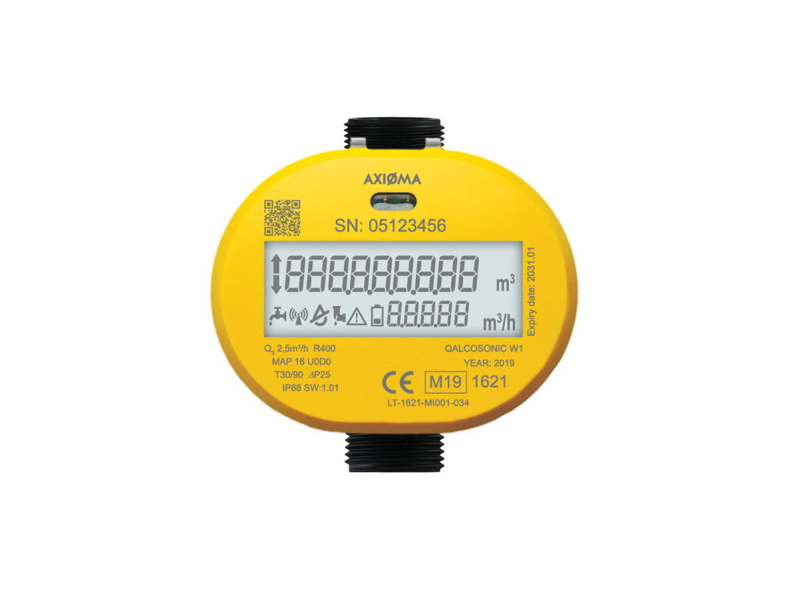
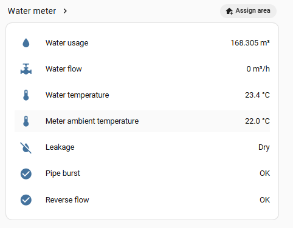

# qalcosonic-lora

Read an **Axioma Qalcosonic W1** water meter over NFC and deliver the readings
to **MQTT / Home Assistant** over a **433 MHz LoRa** link — for meters installed
where there is no Wi-Fi (meter pits, basements, outside walls).

```
 ┌──────────── at the meter ────────────┐            ┌──────────── indoors ─────────────┐
 │ Qalcosonic W1 ◄─NFC─► PN5180         │   LoRa     │ DX-LR30 ──► ESP32 ──Wi-Fi──► MQTT │
 │                        │             │  433 MHz   │                         │         │
 │                      ESP32 ─► DX-LR30│ ─────────► │                  Home Assistant   │
 │        (deep sleep, battery/power bank)           │        (auto-discovery)           │
 └──────────────────────────────────────┘            └───────────────────────────────────┘
        qalcosonic_lora_reader                              qalcosonic_lora_publisher
```

The project is two Arduino sketches:

| Sketch | Role |
|---|---|
| [`qalcosonic_lora_reader/`](qalcosonic_lora_reader) | Sits at the meter. Wakes from deep sleep, reads the meter over NFC (PN5180), sends one LoRa packet, goes back to sleep. No Wi-Fi. |
| [`qalcosonic_lora_publisher/`](qalcosonic_lora_publisher) | Indoor gateway. Listens on LoRa, publishes the readings to MQTT, and announces sensors via Home Assistant MQTT discovery. |

## Features

- **NFC readout of the Qalcosonic W1** via the meter's ST25DV tag mailbox using
  wired M-Bus frames (`SND_NKE` / `REQ_UD2`); the tag is powered by energy
  harvesting so the meter's sealed battery is not used for the transfer.
- **Values decoded:** total / forward / reverse volume, flow, water and ambient
  temperature, meter battery, meter clock, operating time, serial number, and
  the meter's alarm flags (leakage, burst, reverse flow, low battery, freeze, …).
- **Low-power reader:** one job per wake, then deep sleep with the LR30 in cold
  sleep and the PN5180 held in hard power-down; control pins are latched through
  sleep so neither chip leaks current.
- **Power-bank keep-alive:** optional short current pulses during sleep so
  USB power banks don't switch off.
- **Robust link:** fixed 54-byte binary packet with magic/version checks,
  sequence numbers for duplicate and loss detection, optional repeated
  transmissions, and per-node IDs.
- **Home Assistant discovery:** water usage (`total_increasing`, Energy
  dashboard ready), flow, temperatures, battery, LoRa RSSI/SNR, alarm binary
  sensors, and a reader-link connectivity sensor. Entities go unavailable when
  either the gateway or the reader stops reporting.

## Supported meters

| Meter | Status | Notes |
|---|---|---|
| Axioma Qalcosonic W1 | ✅ Supported | Read through its built-in NFC interface. |

<p align="center">
  
  <br>
  <sub>Axioma Qalcosonic W1. Image © <a href="https://www.axiomametering.com/en/products/water-metering-devices/mechanical/qalcosonic-w1">Axioma Metering</a>.</sub>
</p>

Other meters are untested. A meter could work if it:

- has an **ST25DV-type NFC tag** with a mailbox (Fast Transfer Mode) that can be
  powered by energy harvesting from the reader's field, and
- answers **wired M-Bus** requests (`SND_NKE` / `REQ_UD2`) through that mailbox.

The reader doesn't check the meter model; it decodes whatever standard M-Bus
records come back (volume, flow, temperatures, battery, alarms). If you get
another meter working, please open an issue or PR so it can be added here.

## Hardware

Both sides use an **ESP32-WROOM** dev board and a **DX-LR30-433M22S** (SX1262)
LoRa module. The reader additionally has a **PN5180** NFC module.

### Components list

| Component | Qty | Used on | Notes |
|---|---|---|---|
| ESP32-WROOM dev board (e.g. ESP32-DevKitC) | 2 | Reader + publisher | Any ESP32-WROOM board with the GPIOs below broken out. |
| DX-LR30-433M22S LoRa module (SX1262, 433 MHz) | 2 | Reader + publisher | 3.3 V supply only. |
| 433 MHz antenna | 2 | Reader + publisher | One per LR30; never transmit without an antenna attached. |
| PN5180 NFC module | 1 | Reader | Needs both 5 V and 3.3 V. |
| Power bank or battery | 1 | Reader | For a power bank, enable the keep-alive (see *Configuration*). |
| USB power supply (5 V) | 1 | Publisher | The gateway listens continuously, so it needs mains power. |
| Jumper wires / perfboard | — | Both | For the SPI and control wiring. |
| Weatherproof enclosure | 1 | Reader | Recommended for meter pits and outdoor installs. |

### LoRa module (both sides — identical wiring)

| DX-LR30 | ESP32 GPIO |
|---|---|
| VCC | 3V3 (**3.3 V only**) |
| SCK | 18 |
| MISO | 19 |
| MOSI | 23 |
| NSS | 5 |
| RESET | 14 |
| BUSY | 26 |
| DIO1 | 27 |
| TXEN | 32 |
| RXEN | 33 |

### PN5180 (reader only)

The PN5180 shares the VSPI bus with the LR30. NSS is on GPIO 4 (not 14 as in
the upstream project) because GPIO 14 is the LR30 reset.

| PN5180 | ESP32 GPIO |
|---|---|
| SCK | 18 |
| MISO | 19 |
| MOSI | 23 |
| NSS | 4 |
| BUSY | 16 |
| RST | 17 |
| 5V | 5V (RF stage) |
| 3.3V | 3V3 (logic) |

> The PN5180 board needs **both** 5 V and 3.3 V. Place its antenna flat over
> the NFC area on the meter's face; position matters (see *Troubleshooting*).

## Building

1. Install the **ESP32 Arduino core** (Boards Manager → *esp32* by Espressif).
2. Install the libraries from the Library Manager:
   - **RadioLib** (Jan Gromes) — both sketches
   - **PubSubClient** (Nick O'Leary) — publisher only
3. Edit each sketch's `config.h` (see below).
4. Open each folder in the Arduino IDE (or `arduino-cli`), select an ESP32 dev
   board, and flash it.

```sh
arduino-cli compile --fqbn esp32:esp32:esp32 qalcosonic_lora_reader
arduino-cli compile --fqbn esp32:esp32:esp32 qalcosonic_lora_publisher
```

> `lora_link.h`, `lora_link.cpp` and `meter_packet.h` exist in **both** sketch
> folders and **must stay identical** — frequency, spreading factor, bandwidth,
> coding rate, sync word and the packet layout have to match on both sides.

## Configuration

### Publisher — `qalcosonic_lora_publisher/config.h`

| Setting | Default | Description |
|---|---|---|
| `WIFI_SSID` / `WIFI_PASSWORD` | `""` | Wi-Fi credentials. |
| `DEVICE_NAME` | `qalcosonic-lora-gw` | Hostname and MQTT client ID. |
| `MQTT_HOST` / `MQTT_PORT` | `""` / `1883` | Broker address. |
| `MQTT_USER` / `MQTT_PASSWORD` | `""` | Leave the user empty for anonymous access. |
| `MQTT_BASE_TOPIC` | `watermeter/qalcosonic` | Prefix for all topics. |
| `HA_DISCOVERY` | `1` | Publish Home Assistant discovery configs. |
| `HA_DISCOVERY_PREFIX` | `homeassistant` | HA discovery prefix. |
| `HA_DEVICE_ID` | `qalcosonic_w1` | HA device / `unique_id` prefix. |
| `READER_NODE_ID` | `1` | Must match the reader's `NODE_ID`. |
| `READER_TIMEOUT_MS` | `10800000` (3 h) | Mark the reader offline after this long without packets. Keep it ≈ 3× the reader's poll interval. |
| `LORA_TX_POWER_DBM` | `10` | Transmit power (−9…22 dBm). |

> Don't commit real credentials. Keep your filled-in `config.h` local.

### Reader — `qalcosonic_lora_reader/config.h`

| Setting | Default | Description |
|---|---|---|
| `NODE_ID` | `1` | Must match the publisher's `READER_NODE_ID`. |
| `POLL_INTERVAL_MS` | `3600000` (1 h) | Time between meter reads. Every read wakes the meter and costs its sealed battery a little — use short intervals only for bench testing. |
| `RADIO_RETRY_MS` | `30000` | Sleep time before retrying when the LR30 fails to start. |
| `MIN_SLEEP_MS` | `1000` | Shortest deep sleep ever used. |
| `KEEPALIVE_INTERVAL_MS` | `5000` | Power-bank keep-alive period. **Set to `0` on a bare battery.** |
| `KEEPALIVE_PULSE_MS` | `1000` | Length of each keep-alive current burst. |
| `KEEPALIVE_WIFI` | `1` | `1` = Wi-Fi radio on during the pulse (~100+ mA), `0` = busy CPU only (~40–60 mA). |
| `TX_REPEATS` / `TX_REPEAT_GAP_MS` | `2` / `400` | Send each packet N times; the publisher drops duplicates. |
| `LORA_TX_POWER_DBM` | `10` | Transmit power (−9…22 dBm). |
| `PIN_PN5180_*` | see wiring | PN5180 pins. |
| `VERBOSE_NFC_LOG` | `0` | `1` = log every ISO 15693 frame. |

### Radio — `lora_link.h` (both sides)

| Setting | Default | Notes |
|---|---|---|
| `LORA_FREQ_MHZ` | `433.5` | 433.05–434.79 MHz SRD band. |
| `LORA_BW_KHZ` | `125` | |
| `LORA_SF` | `9` | ~250 ms on air per packet; use 11–12 for more range. |
| `LORA_CR` | `5` (4/5) | |
| `LORA_SYNC_WORD` | `0x34` | |

> **Regulatory:** 433 MHz SRD rules in many regions limit transmit power to
> about 10 mW (10 dBm) and restrict duty cycle. Check your local limits before
> raising power or polling more often.

## MQTT topics

All topics are under `MQTT_BASE_TOPIC` (default `watermeter/qalcosonic`).

| Topic | Retained | Payload |
|---|---|---|
| `<base>/state` | yes | Latest meter reading (JSON, below). |
| `<base>/status` | yes | Gateway: `online`, `offline` (LWT) or `radio_error`. |
| `<base>/reader` | yes | Reader: `online` / `offline` (based on `READER_TIMEOUT_MS`). |
| `<base>/error` | no | Reader-side readout failure: `{"error":"…","code":N,"consecutive_errors":N}`. |
| `<base>/link` | no | Every packet's RSSI, SNR, frequency error, sequence and lost-packet count. |

Example `state` payload:

```json
{
  "volume_m3": 123.456,
  "flow_m3h": 0.000,
  "water_temp_c": 14.25,
  "external_temp_c": 18.5,
  "battery_pct": 96,
  "operating_time_s": 98765432,
  "meter_time": "2026-11-21 18:00",
  "meter_id": "12345678",
  "serial_number": "12345678",
  "error_flags_raw": "00 00 00 00",
  "alarms": {
    "leakage": false, "burst": false, "reverse_flow": false,
    "low_battery": false, "freeze_alert": false, "...": false
  },
  "lora": { "rssi_dbm": -92.0, "snr_db": 7.5, "freq_error_hz": 812, "seq": 42, "lost_packets": 0 },
  "reader_uptime_s": 151200
}
```

Fields the meter didn't send are omitted (`volume_m3` is `null` if missing).

## Home Assistant

With `HA_DISCOVERY` enabled, a **Water meter** device appears automatically with:

- **Sensors:** Water usage (m³, usable in the Energy dashboard), Water flow,
  Water temperature, Meter ambient temperature, Meter battery, Meter ID,
  LoRa RSSI, LoRa SNR
- **Binary sensors:** Leakage, Pipe burst, Reverse flow, Meter low battery,
  Meter reader link



## How it works

**Reader cycle** (all in `setup()`; `loop()` is never reached):

1. Wake from deep sleep. If the next poll isn't due yet, this is a power-bank
   keep-alive wake: pulse current and go back to sleep.
2. Start the PN5180 and the LR30. On a real power-on, send a `HELLO` packet.
3. Read the meter: ISO 15693 inventory → check ST25 energy harvesting → enable
   the mailbox → M-Bus `SND_NKE` → `REQ_UD2` → decode the long frame.
4. Send a `READING` packet, or an `ERROR` packet with the failure reason.
5. Put both chips to sleep, latch the control pins, and deep-sleep until the
   next poll. Sequence number, error streak and next poll time live in RTC memory.

**Publisher** listens continuously, validates each packet (length, magic,
version, node ID), drops duplicates, counts lost packets, and publishes to
MQTT. A `HELLO` resets sequence tracking.

## Troubleshooting

| Symptom | Likely cause |
|---|---|
| `PN5180 not responding` | Missing 5 V or 3.3 V supply, or wrong BUSY / RST / NSS wiring. |
| `meter not found (antenna position)` | Antenna isn't over the meter's NFC area — reposition it. |
| `energy harvesting not active (field too weak)` | Reader is too far from the meter; move it closer. |
| `no reply to M-Bus SND_NKE / REQ_UD2` | Marginal NFC coupling; adjust antenna position. |
| Publisher logs `CRC error` | Signal too weak or interference — raise `LORA_SF`, improve antennas or placement. |
| `packet version … update both sides` | `meter_packet.h` differs between the sketches. |
| Reader stops after a while on a power bank | Bank turned off: shorten `KEEPALIVE_INTERVAL_MS`, lengthen `KEEPALIVE_PULSE_MS`, or set `KEEPALIVE_WIFI 1`. |

## Credits

- Meter protocol and PN5180 driver ported from
  [dbmaxpayne/esphome_qalcosonicnfc](https://github.com/dbmaxpayne/esphome_qalcosonicnfc)
  (Mark Hermann), based on
  [ATrappmann/PN5180-Library](https://github.com/ATrappmann/PN5180-Library)
  (Andreas Trappmann).
- LR30 radio setup follows `svcisr/lora-door-sensor`.

## License

[MIT](LICENSE), except the PN5180 driver files
(`qalcosonic_lora_reader/PN5180*`) and the ported meter protocol, which keep
their upstream **LGPL v2.1+** license.
